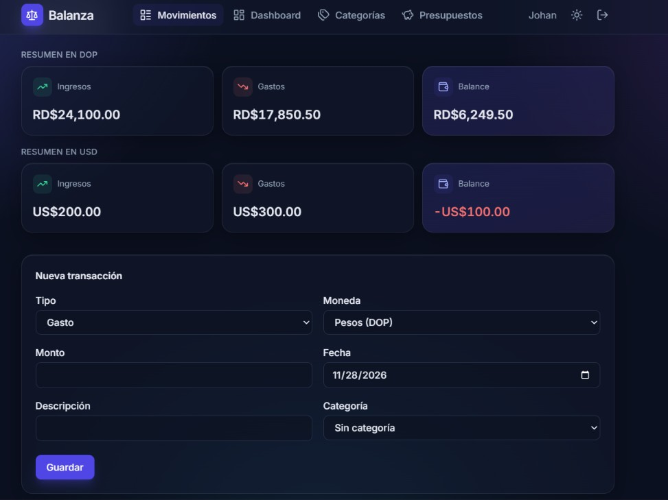
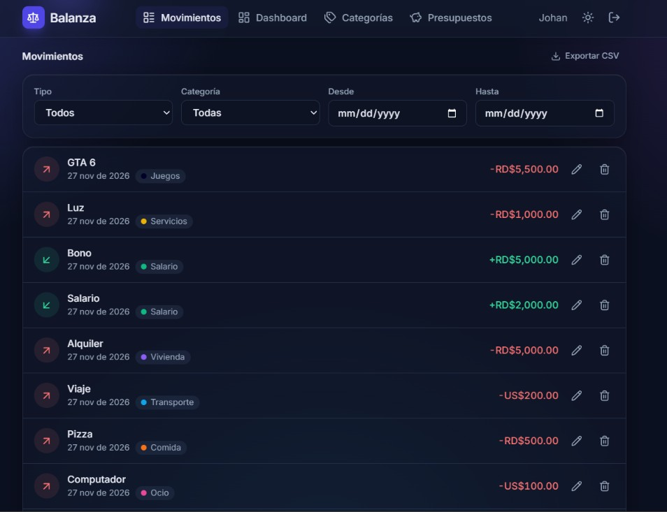
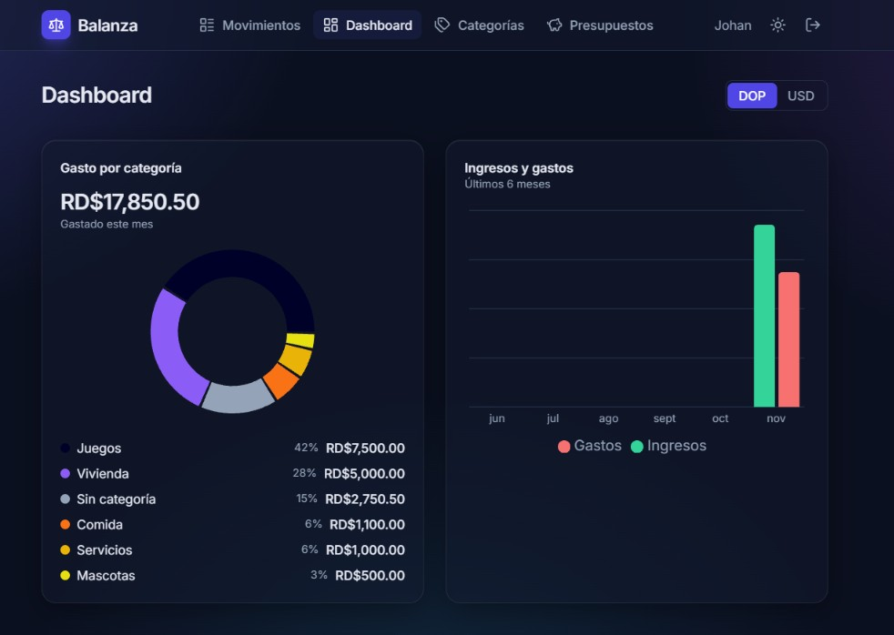
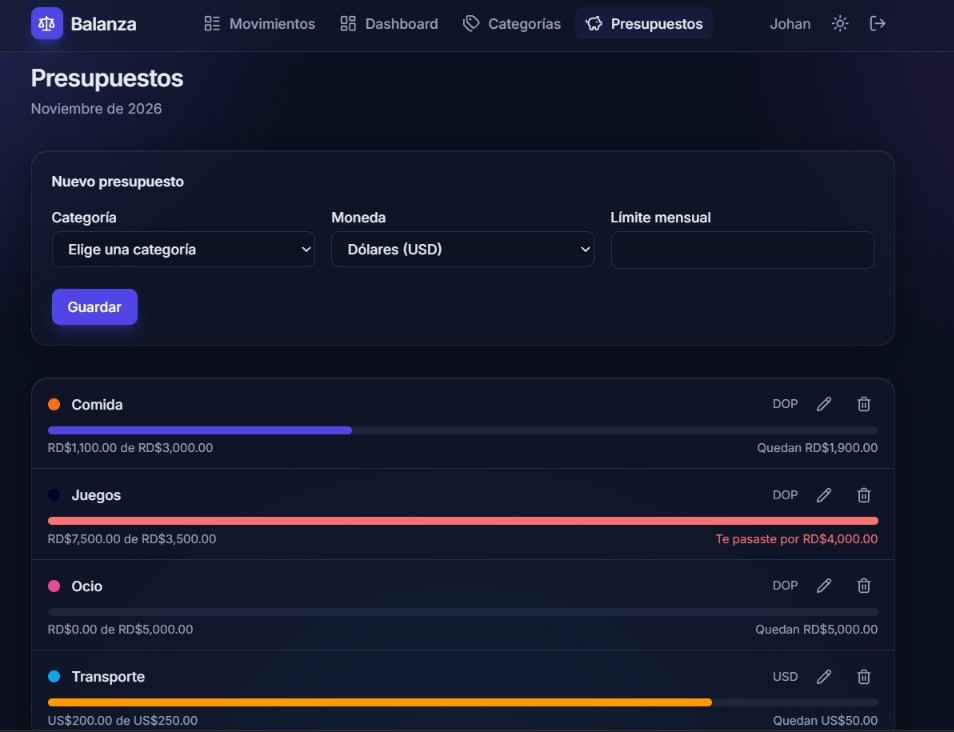

# Balanza


Gestor de gastos personales: registra ingresos y gastos en pesos o dólares, organízalos por categorías, ponles un límite mensual y mira a dónde se va tu dinero.

## Funciones

- **Cuentas de usuario** con registro, inicio de sesión y datos separados por usuario
- **Transacciones** de ingreso y gasto en DOP o USD, con edición, eliminación y resumen de balance
- **Categorías** con color propio, y un conjunto por defecto al registrarse
- **Presupuestos mensuales** por categoría, con barra de progreso y aviso al acercarte o pasarte del límite
- **Dashboard** con el gasto del mes por categoría (dona) y la evolución de ingresos y gastos de los últimos 6 meses (barras)
- **Filtros** por tipo, categoría y rango de fechas
- **Exportar a CSV** lo que estás viendo, compatible con Excel
- Interfaz **responsive**, con tema claro y oscuro

## Capturas

**Movimientos**

| Resumen y formulario | Lista de movimientos |
| --- | --- |
|  |  |

**Dashboard y presupuestos**

| Dashboard | Presupuestos |
| --- | --- |
|  |  |

## Stack

| Parte | Tecnologías |
| --- | --- |
| Cliente | React, TypeScript, Vite, Tailwind CSS, React Router, TanStack Query, Recharts |
| Servidor | Node.js, Express, TypeScript, Zod, JWT, bcrypt |
| Base de datos | PostgreSQL (Neon) con Prisma ORM |
| Calidad | Vitest, Supertest, GitHub Actions |

## Estructura

```
Balanza/
├── client/              # Aplicación React (Vite)
├── server/              # API con Express y Prisma
│   ├── prisma/          # Esquema y migraciones
│   ├── src/modules/     # auth, transactions, categories, budgets, stats
│   └── tests/           # Pruebas de la API
└── .github/workflows/   # Integración continua
```

## Correrlo en local

### Requisitos

- Node.js 24 o superior
- Una base de datos PostgreSQL. Con [Neon](https://neon.tech) se puede crear una gratis.

### 1. Servidor

```bash
cd server
npm install
cp .env.example .env
```

Abre `server/.env` y completa los valores (ver la tabla de variables más abajo). Para el secreto del JWT puedes generar uno así:

```bash
node -e "console.log(require('crypto').randomBytes(32).toString('hex'))"
```

Después aplica las migraciones, genera el cliente de Prisma y arranca:

```bash
npx prisma migrate deploy
npx prisma generate
npm run dev
```

La API queda en <http://localhost:3001>. Para comprobarlo, abre `/api/health`.

### 2. Cliente

En otra terminal:

```bash
cd client
npm install
npm run dev
```

Abre <http://localhost:5173>. En desarrollo, Vite reenvía las llamadas `/api` al servidor, así que no hay que configurar nada más.

## Variables de entorno

| Variable | Dónde | Para qué |
| --- | --- | --- |
| `PORT` | `server/.env` | Puerto de la API (3001 por defecto) |
| `DATABASE_URL` | `server/.env` | Cadena de conexión de PostgreSQL |
| `JWT_SECRET` | `server/.env` | Secreto con el que se firman los tokens |
| `TEST_DATABASE_URL` | `server/.env` | Base de datos exclusiva para las pruebas |
| `VITE_API_URL` | cliente | URL de la API, solo necesaria en producción |

## API

Todas las rutas, salvo `/api/health`, el registro y el login, exigen el encabezado `Authorization: Bearer <token>`.

| Recurso | Rutas |
| --- | --- |
| Autenticación | `POST /api/auth/register`, `POST /api/auth/login`, `GET /api/auth/me` |
| Transacciones | `GET /api/transactions` (filtros: `type`, `categoryId`, `from`, `to`), `POST`, `PATCH /:id`, `DELETE /:id` |
| Categorías | `GET /api/categories`, `POST`, `POST /defaults`, `PATCH /:id`, `DELETE /:id` |
| Presupuestos | `GET /api/budgets?month=AAAA-MM` (incluye lo gastado), `POST`, `PATCH /:id`, `DELETE /:id` |
| Estadísticas | `GET /api/stats/by-category`, `GET /api/stats/monthly` |

## Pruebas

Las pruebas de la API usan su propia base de datos y nunca tocan la real:

1. Crea una rama `test` en Neon (o cualquier base PostgreSQL aparte) y copia su cadena de conexión.
2. Agrégala a `server/.env` como `TEST_DATABASE_URL`.
3. Corre las pruebas desde `server/`:

```bash
npm test
```

Las migraciones se aplican solas a la base de pruebas. Si `TEST_DATABASE_URL` falta o es igual a `DATABASE_URL`, las pruebas se niegan a correr.

## Integración continua

En cada pull request y en cada push a `main`, GitHub Actions corre:

- **Cliente:** lint y build (incluye la revisión de tipos)
- **Servidor:** revisión de tipos y pruebas contra un Postgres temporal, aplicando las migraciones desde cero

## Versiones

El historial de cambios está en [Releases](https://github.com/johanbonifacio15/Balanza/releases).